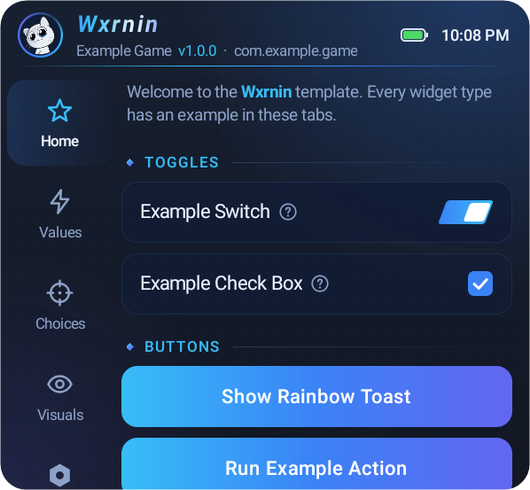
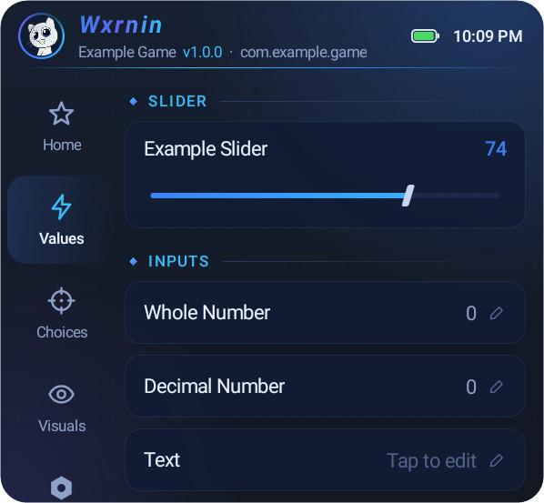
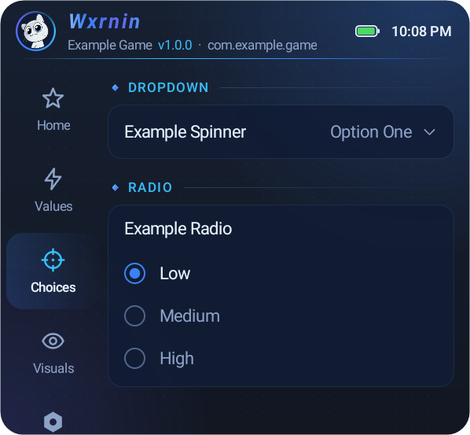
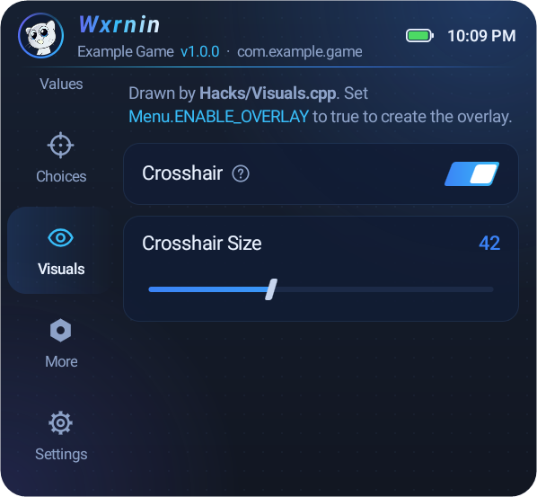
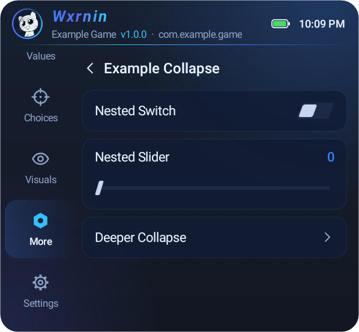
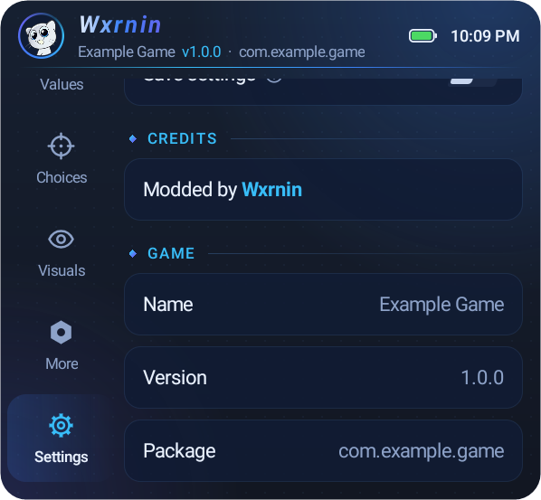

<p align="center">
  &nbsp;&nbsp;
  
</p>

<p align="center">
  
</p>

# Wxrnin Mod Menu Template

## Showcase

Screenshots taken on LDPlayer 9 (Android 9, 1600x900, 240 dpi). In the app, the logo GIF plays, the bubble ring spins and the title and toast colors move.

| Values | Choices |
| :---: | :---: |
|  |  |
| **Visuals** | **Nested collapse** |
|  |  |
| **Settings** | **Rainbow toast** |
|  |  |

This template by **Wxrnin** is based on the R3DNETWORKID Android Template and [LGL Mod Menu](https://github.com/LGLTeam/Android-Mod-Menu/). Since the original project is no longer actively maintained, We have made several modifications, including:

- **UI Changes**: Updated the menu interface.
- **New Modules**: Added additional modules to extend functionality.
- **Obfuscation**:
  - Integrated [BlackObfuscator](https://github.com/CodingGay/BlackObfuscator-ASPlugin) for enhanced code obfuscation.
  - Added [LSParanoid](https://github.com/LSPosed/LSParanoid) to provide string encryption for securing sensitive text data.

# Prerequisites
Before we can jump head first into working a template, we need to go over a few things.

* **AN EXPERIENCED MODDER** You should be able to mod any games in general, like modifying .so files, dll files, smali files, etc.
* Android Studio, i don't think this project could compile on android software like AIDE 
* Basic knowledge of smali dalvik opcodes to modify smali
* Basic knowledge ARM and ARM64 assembly, to be able to patch hex (No need x86)
* Basic knowledge of C++ and java (JNI is optional)
* Be able to write hook function in C++ (Not really needed, but recommended if you want to do advanced modding in the future)
* Basic awareness of how Android layout works in XML and Java. This project only use Java for layout but you will learn it easly
* Time and patience: Don't start working on this if you have deadlines or important work. Take your time to read, learn and get used to work with this project.
* DIY (Do it yourself): Yes, you must be able to do things yourself, not depending being spoonfeed. We are not the teachers.
* An inquisitive mind

We are not babysitters for naive, lazy, pathetic children... Grow up. Read and learning by yourself is mandatory!


> [!NOTE]\
> Starting from version 1.3, `Il2cppResolver` has been replaced with `UnityResolve` to offer more extensive API support and improved functionality.
> 
> New feature suggestions or bugs can be commit as issues.

## Wxrnin Template

A clean starting point: no game features and no hooks are active. Every widget has one example, wired end to end, so you can copy the one you need.

| File | What to edit |
| --- | --- |
| `jni/Menu/FeatureModule.cpp` | The widgets (one example of each) and `OnFeatureChanged`, which stores their values |
| `jni/Hacks/Vars.h` | The variables your features read |
| `jni/Hacks/Hooks.cpp` | Commented examples: hook by name (il2cpp API), hook by offset, KittyMemory hex patch, game-thread `Update` |
| `jni/Hacks/Visuals.cpp` | Overlay drawing (crosshair example, ESP outline). Set `Menu.ENABLE_OVERLAY = true` in `Menu.java` to create the overlay |
| `jni/Menu/Setup.cpp` | Title, credits, start-up toast and the target game shown in the menu (`GAME_NAME`, `GAME_VERSION`, `GAME_PACKAGE`) |
| `jni/Includes/Logo.h` | The logo as base64: PNG, JPG or **animated GIF** |
| `java/.../components/Theme.java` | Colors (blue theme), sizes and fonts |

### Menu Layout

A floating bubble (the logo inside a spinning gradient ring) opens a panel with a tab sidebar on the left and feature cards on the right. The header shows the logo, the name with a shimmer effect, and the target game name, version and package.

```cpp
Widget::Add(ITab(OBFUSCATE("Visuals"), OBFUSCATE("eye"), {
        ITab::Child(ISwitch(1, OBFUSCATE("ESP"), OBFUSCATE("Shown when tapping the ? badge"))),
        ITab::Child(ICollapse(OBFUSCATE("Crosshair Settings"), {
                ICollapse::Child(ISlider(3, OBFUSCATE("Crosshair Size"), 10, 100)),
        })),
}));
```

Widgets: `ITab`, `ICategory`, `ITextView`, `ISwitch`, `ICheckBox`, `ISlider`, `ISpinner`, `IRadioButton`, `IButton`, `IButtonLink`, `IInputInt`, `IInputFloat`, `IInputText`, `ICollapse` (can be nested).

Tab icons: `grid`, `hex`, `bell-off`, `wand`, `shield`, `eye`, `target`, `user`, `bolt`, `gear`, `info`, `star`, `gamepad`, `sword`. Widgets added outside an `ITab` go into a "General" tab. A "Settings" tab is added automatically with a "Save settings" switch (restores your last values on the next start), the credits and the target game info.

### Rainbow Toast

`Menu::showToast(env, context, "text", ToastLength::LENGTH_SHORT)` shows a toast with animated rainbow text, a rainbow border and the logo. Without the overlay permission it falls back to a system toast with rainbow-colored letters. `OnFeatureChanged` receives the context as `obj`, so buttons can show one directly (see the "Show Rainbow Toast" example).

### Logo

`Includes/Logo.h` holds the logo as base64. An animated GIF plays on the bubble, in the header and in the toast. Keep it small, because it is stored inside the `.so`: crop it to a square of about 128x128. The default is a 44-frame GIF of about 170 KB. The logo is drawn inside a circle, so give it an opaque background matching `Theme.CARD_BG` or a transparent one.

> [!NOTE]\
> ndk-build fails when the project path contains spaces ("Your APP_BUILD_SCRIPT points to an unknown file"). Build from a folder without spaces, e.g. `C:\Modding\WxrninModMenu`.

## How to use
To enable and display a floating menu in your target app, follow these steps:

#### 1. Request Permission for Floating Menu
To allow your target app to draw a floating menu overlay on top of other apps, add the following permission to your AndroidManifest.xml file:

```xml
<uses-permission android:name="android.permission.SYSTEM_ALERT_WINDOW" />
```

This permission is required for overlaying UI elements, such as a floating menu, across other applications.

#### 2. Register the Service to Show the Menu
To activate the floating menu, declare a service in `AndroidManifest.xml` to your targer app. This service will handle the display and lifecycle of the floating menu:

```xml
<service android:name="com.android.support.Launcher" android:enabled="true" android:exported="true" android:stopWithTask="true" />
```

#### 3. Call the Loader class
To integrate and initialize the floating menu loader, add the following code in the `onCreate` method within `UnityPlayerActivity.smali`. If your target app uses a custom launcher activity, locate it in `AndroidManifest.xml` and insert the code in that activity’s `onCreate` method instead.

```smali
invoke-static {p0}, Lcom/android/support/Loader;->Start(Landroid/content/Context;)V
```

If you prefer not to use `Remap` , simply call this method:
```smali
invoke-static {p0}, Lcom/android/support/Main;->Start(Landroid/content/Context;)V
```

## Customizing Fonts  

You can integrate custom fonts into your project using a `C array`. To generate the required font data, you can use a hexadecimal editor such as [ImHex](https://github.com/WerWolv/ImHex).

#### 1. Exporting the Font  

To export a font, follow these steps:  

1. Load the `.ttf` font file into ImHex.  
2. Navigate to the **File** tab and select **Export**.  
3. Choose **Text Formatted Bytes** -> **C Array**.  
4. Save the exported data as a `.h` file.  

#### 2. Importing the Font into Your Project  

1. Copy the exported `.h` font file to the `Includes/Fonts/` directory.  
2. Open `Menu/JNILoader.cpp` and include your font header in `Includes/Fonts/`.  
3. Locate the `JNILoader::LoadFontData` method and modify it to use the newly exported font.  

#### Example: Modifying `LoadFontData`  

```cpp
jbyteArray JNILoader::LoadFontData(JNIEnv *env, jobject thiz, jobject ctx) {
    // Create a byte array in Java to hold the font data
    jbyteArray fontData = env->NewByteArray(std::size(font));

    // Populate the byte array with the embedded font data
    env->SetByteArrayRegion(fontData, 0, std::size(font), (jbyte*)font);

    return fontData;  // Return the font data as a byte array
}
```

#### 3. Updating the Font Variable
Replace the `font` variable in the code above with the array from your exported font file. This ensures that the custom font is correctly loaded and utilized in the project.

#### 4. Enabling the Font in the Menu
The menu uses the system sans-serif font by default. Set `Theme.USE_CUSTOM_FONT = true` in `components/Theme.java` to use the font returned by `LoadFontData`.

## Project
- [Arknights DLC](https://github.com/seedhollow/arknights-dlc) Simple Game Helper for better experience.

## Credits
- LGL Team.
- [UnityResolve](https://github.com/issuimo/UnityResolve.hpp)
- [Dobby](https://github.com/jmpews/Dobby/)
- [Remap Hide](https://github.com/reveny/Android-Library-Remap-Hide)

## Suggestions
If you have any questions or requests related to this project, feel free to open an issue.

## Disclaimer
This project is for Educational Use only. We do not condone this project being used to gain an advantage against other people. This project was made for fun.

We strongly refrain you from buying any source codes on Telegram even if the author can be trusted, there is always a risk getting scammed. We will not be responsible for that. This project is always FREE to use
